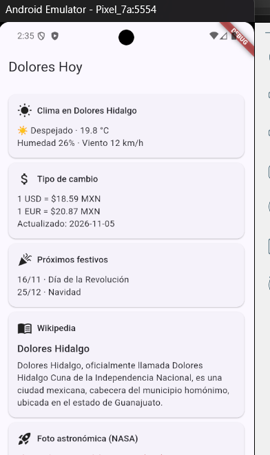
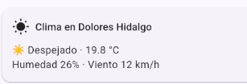
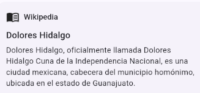

# Dolores Hoy 📱☀️

Una aplicación móvil desarrollada en **Flutter** para la gestión de servicios, consulta del clima, cambio de divisas, eventos festivos, imágenes de la NASA y artículos de Wikipedia en **Dolores Hidalgo, Guanajuato**.

---

## 📸 Capturas de Pantalla

| Inicio / Login | Clima | Cambio de Divisas |
| :---: | :---: | :---: |
|  |  |  |

| Festivos | Wikipedia / NASA |
| :---: | :---: |
|  |  |

---

## 🛠️ Tecnologías y Herramientas

- **Framework:** [Flutter](https://flutter.dev/) (Dart)
- **Patrón de Arquitectura:** MVVM (Model-View-ViewModel) / Clean Architecture
- **Peticiones HTTP:** Package `http`
- **Control de Versiones:** Git & GitHub

---

## 🚀 Instalación y Configuración

1. **Clonar el repositorio:**
   ```bash
   git clone [https://github.com/vic0307/dolores_hoy.git](https://github.com/vic0307/dolores_hoy.git)
   cd dolores_hoy